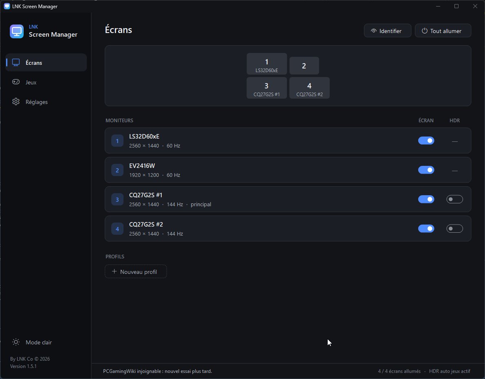
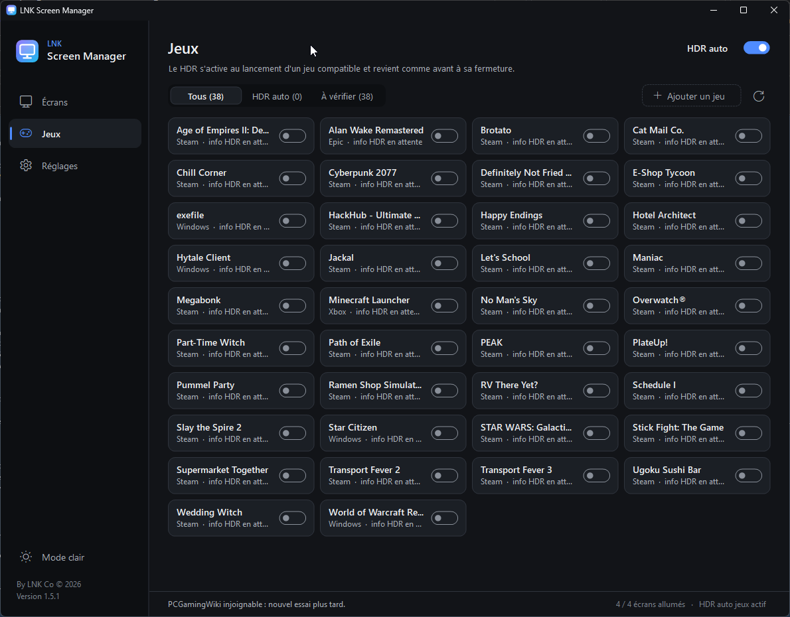
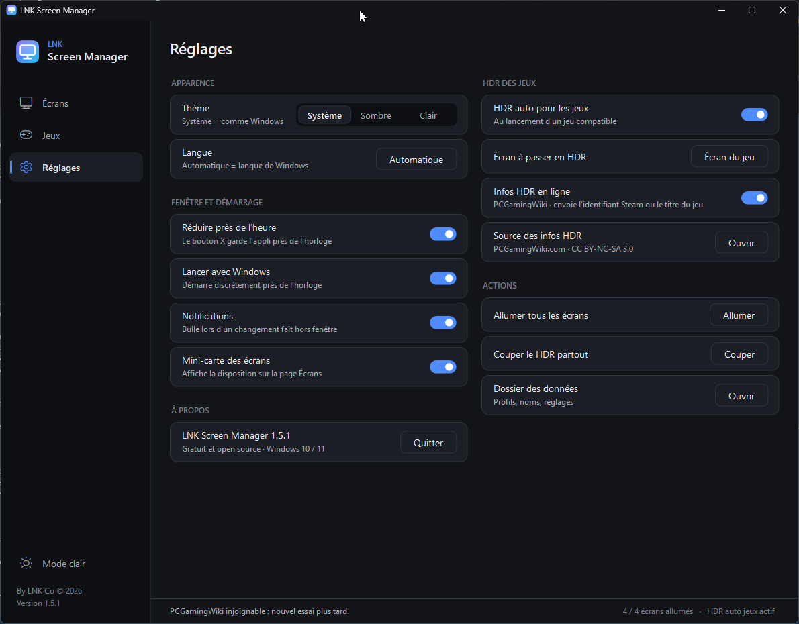
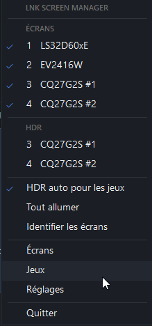

# LNK Screen Manager

By LNK Co © 2026 — free and open source (MIT license) · *gratuit et open source (licence MIT)*

Turn your screens on / off and toggle HDR in one click, without digging through Windows Settings — with automatic HDR when a game starts.
*Allumer / éteindre ses écrans et gérer le HDR en un clic — avec HDR automatique au lancement des jeux.*

**Languages / Langues:** English · Français · Deutsch · Español · Italiano · Português (follows Windows automatically, can be changed in Settings).

[English](#english) · [Français](#français) · 📖 **[Wiki / documentation](https://git.linkatplug.be/linkatplug/LNK-Screen-Manager/wiki)**

### Screenshots / Captures d'écran

<p align="center">
  <br>
  <sub><b>Screens</b>: one <i>Screen</i> and one <i>HDR</i> switch per monitor · <i><b>Écrans</b> : un interrupteur Écran et HDR par moniteur</i></sub>
</p>

<table>
  <tr>
    <td align="center" width="50%">
      <br>
      <sub><b>Games</b>: auto HDR per game · <i><b>Jeux</b> : HDR auto par jeu</i></sub>
    </td>
    <td align="center" width="50%">
      <br>
      <sub><b>Settings</b> · <i><b>Réglages</b></i></sub>
    </td>
  </tr>
</table>

<p align="center">
  <br>
  <sub><b>Tray menu</b> (right-click the icon next to the clock) · <i><b>Menu près de l'heure</b> (clic droit sur l'icône)</i></sub>
</p>

---

## English

### Features
- **Screens**: one *Screen* switch and one *HDR* switch per monitor, layout mini-map, custom names (“Main”, “Top left”…), identify.
- **Profiles**: save your screen setup (e.g. “Gaming”) and apply it in one click, from a desktop shortcut or the command line.
- **Auto HDR for games**: games are detected automatically (Steam, Epic, GOG, Xbox / PC Game Pass, EA, Ubisoft, Battle.net, Amazon, Riot, games known to Windows, manual add). A compatible game switches its screen to HDR when it starts; the previous state comes back when it closes. “Play in HDR” shortcut for games that only check HDR at startup.
- **Tray icon** next to the clock: profiles, screens and HDR on right-click. The X button minimizes the app there (can be turned off).
- Dark / light / system theme, 6 languages, sharp at any display scaling (100 % to 200 %, mixed-DPI setups), automatic compact layout on small screens.
- **Lightweight**: ~2-4 MB of RAM and 0 % CPU when idle (no polling).

### Install
Nothing to install: copy `LNK Screen Manager.exe` anywhere and run it. Windows 10 or 11 (.NET Framework 4, built into Windows). No admin rights needed.

**SmartScreen warning**: the exe is not code-signed (no paid certificate). On first launch Windows may show “Windows protected your PC”: click **More info**, then **Run anyway**. To check the file, compare its SHA-256 hash with the one published in the release (`Get-FileHash "LNK Screen Manager.exe"`), or build it yourself (see below).

### Data & privacy
- Profiles, screen names, layout and settings: `%APPDATA%\LNK Screen Manager` (nothing else is written, except the Windows startup entry if that option is on).
- The only network access is the optional *Online HDR info* lookup: it sends each game's **public Steam ID** (or, for other stores, its **title**) to PCGamingWiki, once per game. Can be turned off in Settings.
- Anti-cheat safe: the app never touches games, it only changes the Windows display setting.

### Command line
```
"LNK Screen Manager.exe" --profile "Gaming"   apply a profile without opening the window
"LNK Screen Manager.exe" --play "steam:ID"    turn HDR on, then start the game
"LNK Screen Manager.exe" --all-on             turn all screens back on
"LNK Screen Manager.exe" --tray               start minimized next to the clock
```
If a display goes wrong: **Win + P → Extend** turns all screens back on.

### Build
Run `build.bat` (uses the C# compiler shipped with Windows, no dependencies). Sources in `src\`, icon and logo generated in `assets\`.
Adding a language: `src\Lang.cs` (one column in the table).

---

## Français

### Fonctions
- **Écrans** : un interrupteur *Écran* et un interrupteur *HDR* par moniteur, mini-carte de la disposition, noms personnalisés (« Main », « Gauche haut »…), identification.
- **Profils** : enregistre l'état des écrans (ex. « Jeu ») et applique-le en un clic, depuis un raccourci bureau ou en ligne de commande.
- **HDR auto pour les jeux** : jeux détectés automatiquement (Steam, Epic, GOG, Xbox / PC Game Pass, EA, Ubisoft, Battle.net, Amazon, Riot, jeux reconnus par Windows, ajout manuel). Un jeu compatible passe l'écran en HDR à son lancement ; l'état d'avant revient à sa fermeture. Raccourci « Jouer en HDR » pour les jeux qui ne détectent le HDR qu'au démarrage.
- **Icône près de l'heure** : profils, écrans et HDR au clic droit. Le X réduit l'appli à cet endroit (désactivable).
- Mode sombre / clair / comme Windows, 6 langues, net à toutes les échelles d'affichage (100 % à 200 %, écrans d'échelles différentes), mise en page compacte automatique sur petits écrans.
- **Léger** : au repos ~2-4 Mo de RAM et 0 % de processeur (aucune surveillance en boucle).

### Installation
Rien à installer : copier `LNK Screen Manager.exe` où on veut et le lancer. Windows 10 ou 11 (.NET Framework 4, inclus dans Windows). Pas besoin de droits administrateur.

**Avertissement SmartScreen** : l'exe n'est pas signé (pas de certificat payant). Au premier lancement, Windows peut afficher « Windows a protégé votre ordinateur » : cliquer sur **Informations complémentaires** puis **Exécuter quand même**. Pour vérifier l'exe, comparez son empreinte SHA-256 avec celle publiée dans la release (`Get-FileHash "LNK Screen Manager.exe"`), ou compilez-le vous-même (voir plus bas).

### Données et vie privée
- Profils, noms d'écrans, disposition et réglages : `%APPDATA%\LNK Screen Manager` (rien d'autre n'est écrit, sauf la clé de démarrage Windows si l'option est activée).
- Seule connexion réseau : l'option *Infos HDR en ligne* interroge PCGamingWiki avec l'**identifiant Steam public** de chaque jeu (ou son **titre** pour les autres boutiques), une seule fois par jeu. Désactivable dans Réglages.
- Aucun anti-triche concerné : l'appli ne touche jamais aux jeux, elle change uniquement le réglage d'écran de Windows.

### Ligne de commande
```
"LNK Screen Manager.exe" --profile "Jeu"    applique un profil sans fenêtre
"LNK Screen Manager.exe" --play "steam:ID"   active le HDR puis lance le jeu
"LNK Screen Manager.exe" --all-on           rallume tous les écrans
"LNK Screen Manager.exe" --tray             démarre réduit près de l'heure
```
En cas de souci d'affichage : **Win + P → Étendre** rallume tous les écrans.

### Compiler
`build.bat` (utilise le compilateur C# fourni avec Windows, aucune dépendance). Sources dans `src\`, icône et logo générés dans `assets\`.
Ajouter une langue : `src\Lang.cs` (une colonne dans la table).

---

## Credits / Crédits
- Game HDR information: [PCGamingWiki](https://www.pcgamingwiki.com), content licensed under [CC BY-NC-SA 3.0](https://creativecommons.org/licenses/by-nc-sa/3.0/). LNK Screen Manager is not affiliated with PCGamingWiki.
  *Informations HDR des jeux : PCGamingWiki, CC BY-NC-SA 3.0. Non affilié à PCGamingWiki.*
- Steam, Epic Games and Windows are trademarks of their respective owners.

## License / Licence
[MIT](LICENSE) © 2026 LNK Co
